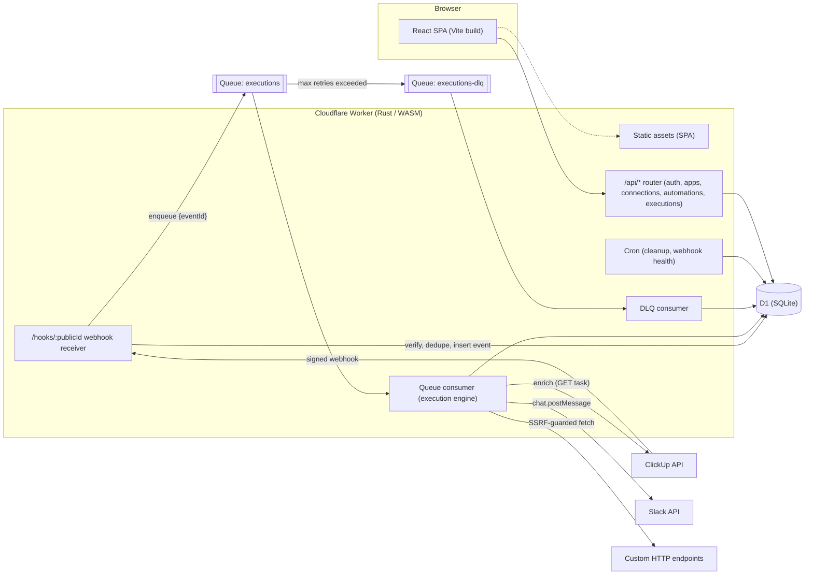
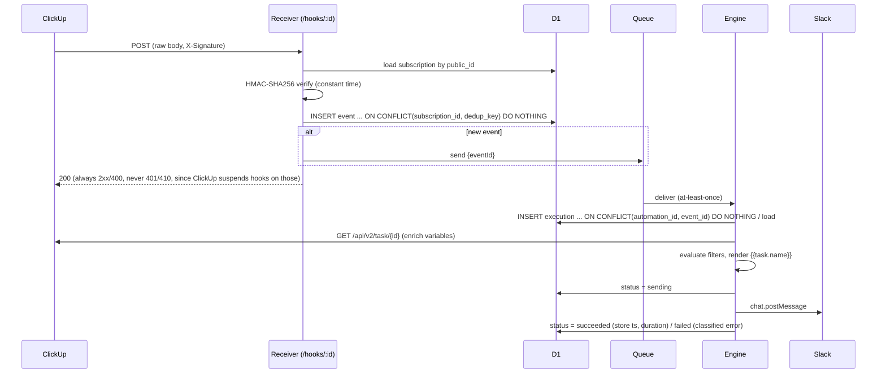
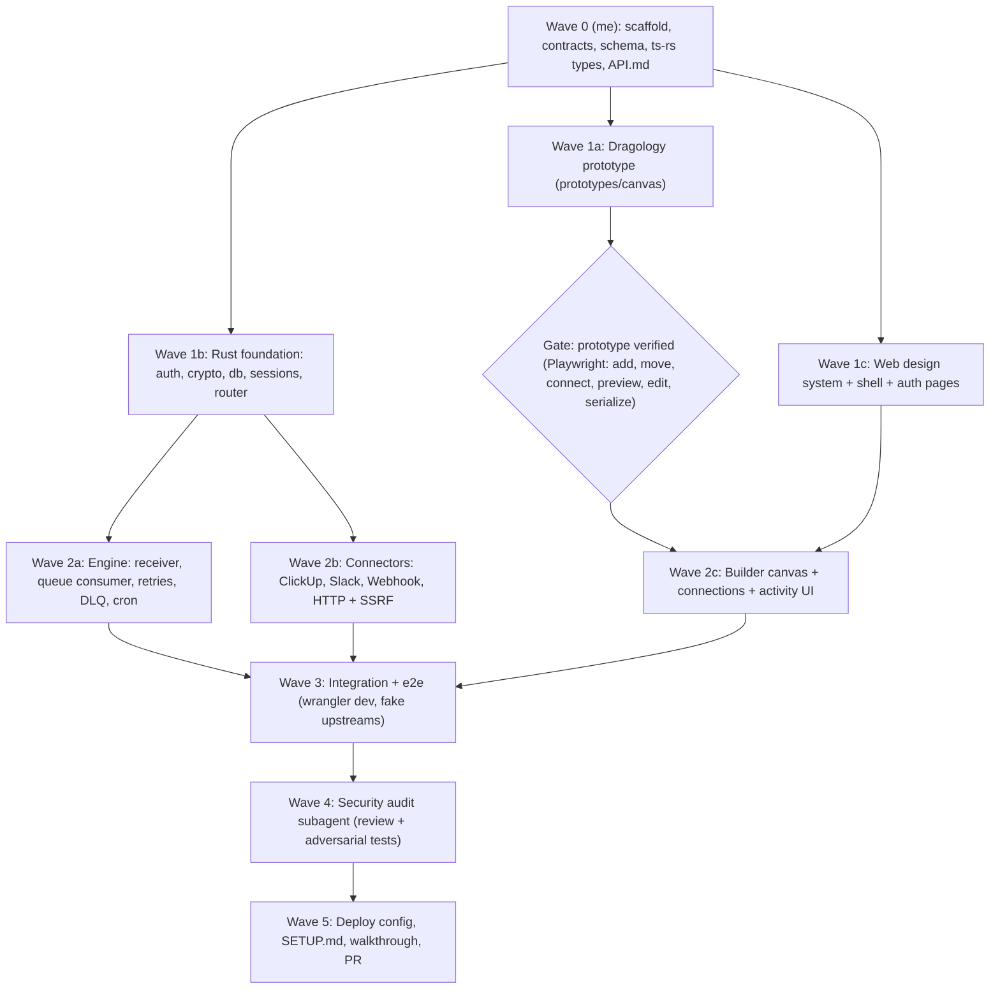

# Integration Hub — Implementation Plan

**Goal:** A non-technical person connects ClickUp → Slack in under 30 seconds.
**Repo:** `Mohammed-gamil/N-connect` (currently empty, no commits).
**Stack (confirmed with you):** Rust Cloudflare Worker (`workers-rs` 0.9, compiled to WASM) + D1 + Queues + Cron · React + TypeScript + Vite + Tailwind + shadcn/ui · Dragology 0.2.0 for the canvas · email/password auth with HttpOnly session cookies.

---

## User Review Required

> [!IMPORTANT]
> **The backend is Rust, not Hono.** Section 5 of your spec said Hono, but you chose Rust. One Rust Worker serves the API, the webhook receiver, the queue consumer and cron, and also serves the built React app as static assets. Everything runs on one origin, so there is no CORS and cookies stay first-party. Types are shared with the frontend by generating TypeScript from the Rust types with `ts-rs`.

> [!WARNING]
> **I cannot fully pass "a real ClickUp task triggers a real Slack message" myself.** You have no Cloudflare, ClickUp or Slack credentials yet. I will:
> 1. Build and test everything locally (`wrangler dev` with local D1 and Queues).
> 2. Add an automated end-to-end test that runs against a **local test-only fake** of the ClickUp and Slack HTTP APIs. This fake is compiled in only when the `e2e` Cargo feature is on; production builds never contain it.
> 3. Write `docs/SETUP.md`, which walks you through creating the Cloudflare resources, the ClickUp OAuth app and the Slack app, setting secrets, and running the real acceptance checklist.
>
> I will **not** claim the real integration works until it has run against the real APIs.

> [!WARNING]
> **"Duplicate events never produce duplicate messages" has one unavoidable edge case.** Slack's `chat.postMessage` has no idempotency key. We de-duplicate at every layer we control: webhook delivery, the queue, and execution records. The remaining risk is a crash *after* Slack accepted the message but *before* we recorded it. A retry in that case could post twice.
> To avoid that, an execution left in `sending` state with an unknown outcome is **not** retried automatically. It is marked "Needs review" and the user can choose **Try again**. This trades a rare missed message for never sending a duplicate. Please confirm you're happy with that.

> [!CAUTION]
> **Cloudflare plan:** I recommend **Workers Paid** (\$5/mo). The free plan allows only 10 ms of CPU per request, which is tight for a WASM cold start plus password hashing. Queue availability on your plan should also be checked during setup.

## Open Questions

1. **App catalog for the MVP.** Your list includes Sheets, Notion, Discord and Telegram, but the MVP scope is ClickUp, Slack, Custom Webhook and HTTP Request. My proposal is to show **only working apps**. Showing "Coming soon" cards could read as fake functionality. OK?
2. **ClickUp sign-in.** I'll build OAuth as the main path. Under "Advanced" I'll also offer pasting a **personal API token**, which makes your first test possible before an OAuth app exists. OK?
3. **Git workflow.** I'll commit in phases to a branch `feat/mvp`, push it, and open a PR against `main`. OK?

---

## 1. System Architecture



### Event lifecycle



### Error classification (drives retries and user messaging)

| Class | Example | Behaviour |
|---|---|---|
| `Retryable { retry_after }` | Slack 429 (`Retry-After`), network error before the request was sent, ClickUp 5xx when enriching | Queue retry with exponential backoff (30s → 2m → 10m → 30m → 2h), at most 5 attempts, then DLQ |
| `NeedsReconnect` | `invalid_auth`, `token_revoked`, `account_inactive` | Fail, mark the connection `needs_attention`, offer **Reconnect** then **Try again** |
| `UserFixable(msg)` | `channel_not_found`, `not_in_channel`, `is_archived` | Fail with a plain-language fix |
| `Unknown outcome` | Crash or timeout while status = `sending` | "Needs review" (see warning above) |
| `Permanent` | Validation bug, missing automation | Fail with a generic explanation; full details only in structured logs |

---

## 2. Cloudflare & API Limitations (identified up front)

| # | Limitation | Mitigation |
|---|---|---|
| 1 | Rust WASM bundle-size limit (3 MB free / 10 MB paid, compressed) | No `reqwest`/`tokio`; use `worker::Fetch`; small RustCrypto crates; `wasm-opt -Oz` |
| 2 | CPU time per request (10 ms free) | Recommend the Paid plan; password hashing via native WebCrypto, not pure Rust |
| 3 | WebCrypto PBKDF2 is capped at **100,000 iterations** on Workers | PBKDF2-SHA256 at 100k iterations + 16-byte salt; versioned hash format so we can upgrade later |
| 4 | D1 has no interactive transactions | Use `batch()` for atomic multi-statement writes; idempotency via `UNIQUE` + `ON CONFLICT` |
| 5 | Queues deliver at least once; 128 KB message limit | Enqueue IDs only; executions are idempotent |
| 6 | No raw DNS or sockets for SSRF checks | Block private and reserved IP literals and internal hostnames, resolve via DNS-over-HTTPS and reject private answers, `redirect: manual`. DNS-rebinding risk documented |
| 7 | Subrequest limits per invocation | Queue batch size 5, at most 3 subrequests per execution |
| 8 | ClickUp `taskCreated` payload has no task name | Engine enriches with `GET /api/v2/task/{task_id}` |
| 9 | ClickUp suspends webhooks that answer 401/410 | Receiver returns 400 on a bad signature, 200 on unknown or paused automations |
| 10 | ClickUp limits the number of webhooks per workspace | MVP creates one webhook per automation and shows a clear error at the limit. Shared fan-out webhooks are a documented follow-up |
| 11 | Slack has no idempotency key | "Needs review" state (see above) |
| 12 | ClickUp webhooks need a public HTTPS URL; `localhost` won't work | SETUP.md: deploy to `*.workers.dev` or use `cloudflared tunnel` |
| 13 | Slack *triggers* (new message) need the Events API | Out of MVP scope. Slack is an **action** only in the MVP |

---

## 3. Repository Layout

```
N-connect/
├── wrangler.toml                 # Worker + assets + D1 + queues + cron
├── package.json                  # pnpm workspace root, scripts
├── docs/
│   ├── ARCHITECTURE.md
│   ├── API.md                    # API contract
│   └── SETUP.md                  # Cloudflare / ClickUp / Slack setup + acceptance checklist
├── worker/                       # Rust Worker crate
│   ├── Cargo.toml
│   ├── migrations/
│   │   ├── 0001_init.sql
│   │   └── 0002_oauth_apps.sql
│   └── src/
│       ├── lib.rs                # #[event(fetch|queue|scheduled)]
│       ├── http/                 # router, middleware (auth, CSRF, request ids), responses
│       ├── routes/               # auth, apps, connections, oauth, automations, executions, dashboard, hooks
│       ├── auth/                 # password hashing, sessions, rate limiting
│       ├── crypto/               # AES-256-GCM envelope, HMAC, random ids, constant-time compare
│       ├── db/                   # typed queries, every one scoped by org_id
│       ├── workflow/             # WorkflowDefinition v1 types (ts-rs export) + validation
│       ├── engine/               # receiver, processor, template renderer, filters, retry policy, error classes
│       ├── connectors/           # mod.rs (trait + registry), clickup.rs, slack.rs, webhook.rs, http.rs
│       ├── ssrf.rs
│       └── e2e_fakes.rs          # only compiled with --features e2e
├── web/                          # React app
│   ├── src/
│   │   ├── generated/            # ts-rs output (WorkflowDefinition, API DTOs)
│   │   ├── components/ui/        # shadcn/ui
│   │   ├── features/{auth,dashboard,builder,connections,activity}/
│   │   ├── canvas/               # Dragology canvas (model, draggable, serialize, history)
│   │   └── lib/api.ts
│   └── tests/                    # vitest + Playwright
├── prototypes/canvas/            # standalone Dragology prototype (Phase 2a)
└── e2e/                          # Miniflare/wrangler-based end-to-end tests
```

---

## 4. Database Schema (D1) — `worker/migrations/0001_init.sql`

Every tenant-owned table carries `org_id`, and every query in `db/` takes `org_id` as a required parameter. Repository functions have no un-scoped variants.

```sql
CREATE TABLE users (
  id TEXT PRIMARY KEY, email TEXT NOT NULL UNIQUE COLLATE NOCASE,
  password_hash TEXT NOT NULL,            -- "pbkdf2-sha256$100000$<salt_b64>$<hash_b64>"
  name TEXT, created_at INTEGER NOT NULL
);
CREATE TABLE organizations (id TEXT PRIMARY KEY, name TEXT NOT NULL, created_at INTEGER NOT NULL);
CREATE TABLE memberships (
  org_id TEXT NOT NULL REFERENCES organizations(id), user_id TEXT NOT NULL REFERENCES users(id),
  role TEXT NOT NULL CHECK (role IN ('owner','member')), PRIMARY KEY (org_id, user_id)
);
CREATE TABLE sessions (
  token_hash TEXT PRIMARY KEY,            -- sha256(cookie token); raw token never stored
  user_id TEXT NOT NULL, org_id TEXT NOT NULL, expires_at INTEGER NOT NULL, created_at INTEGER NOT NULL
);
CREATE TABLE login_attempts (key TEXT PRIMARY KEY, count INTEGER NOT NULL, window_start INTEGER NOT NULL);

CREATE TABLE applications (                -- static catalog, seeded; definitions live in Rust code
  id TEXT PRIMARY KEY, name TEXT NOT NULL, auth_kind TEXT NOT NULL, enabled INTEGER NOT NULL DEFAULT 1
);

CREATE TABLE credentials (                 -- "CredentialReferences": encrypted blobs only
  id TEXT PRIMARY KEY, org_id TEXT NOT NULL, kind TEXT NOT NULL,   -- oauth_token | api_token | webhook_secret | http_auth
  ciphertext BLOB NOT NULL, nonce BLOB NOT NULL, key_version INTEGER NOT NULL,
  created_at INTEGER NOT NULL, rotated_at INTEGER
);                                         -- AES-256-GCM, AAD = org_id || id || kind

CREATE TABLE connections (
  id TEXT PRIMARY KEY, org_id TEXT NOT NULL, application_id TEXT NOT NULL REFERENCES applications(id),
  display_name TEXT NOT NULL,              -- e.g. "Acme Workspace (Slack)"
  external_account_id TEXT,                -- Slack team_id / ClickUp user id
  credential_id TEXT NOT NULL REFERENCES credentials(id),
  status TEXT NOT NULL CHECK (status IN ('connected','needs_attention','revoked')),
  created_by TEXT NOT NULL, created_at INTEGER NOT NULL, updated_at INTEGER NOT NULL
);
CREATE INDEX idx_connections_org ON connections(org_id);

CREATE TABLE oauth_states (
  state_hash TEXT PRIMARY KEY, org_id TEXT NOT NULL, user_id TEXT NOT NULL,
  application_id TEXT NOT NULL, return_to TEXT, expires_at INTEGER NOT NULL
);

CREATE TABLE automations (
  id TEXT PRIMARY KEY, org_id TEXT NOT NULL, name TEXT NOT NULL,
  status TEXT NOT NULL CHECK (status IN ('draft','active','paused','error')),
  definition_version INTEGER NOT NULL, definition_json TEXT NOT NULL,   -- validated WorkflowDefinition
  layout_json TEXT,                        -- visual positions only, independent of execution
  last_execution_at INTEGER, created_by TEXT NOT NULL, created_at INTEGER NOT NULL, updated_at INTEGER NOT NULL
);
CREATE INDEX idx_automations_org ON automations(org_id, status);

-- "Triggers"/"Actions" are denormalized for querying and FK integrity
CREATE TABLE automation_steps (
  automation_id TEXT NOT NULL REFERENCES automations(id) ON DELETE CASCADE,
  org_id TEXT NOT NULL, kind TEXT NOT NULL CHECK (kind IN ('trigger','action')),
  application_id TEXT NOT NULL, event TEXT NOT NULL, connection_id TEXT REFERENCES connections(id),
  PRIMARY KEY (automation_id, kind)
);

CREATE TABLE webhook_subscriptions (
  id TEXT PRIMARY KEY, org_id TEXT NOT NULL, automation_id TEXT NOT NULL REFERENCES automations(id),
  public_id TEXT NOT NULL UNIQUE,          -- 128-bit random, URL-safe; used in /hooks/:publicId
  provider TEXT NOT NULL,                  -- clickup | custom
  external_webhook_id TEXT,                -- ClickUp webhook id
  secret_credential_id TEXT REFERENCES credentials(id),
  verification TEXT NOT NULL,              -- clickup_hmac | hmac_sha256 | shared_token | none
  status TEXT NOT NULL CHECK (status IN ('active','paused','failing','deleted')),
  last_received_at INTEGER, created_at INTEGER NOT NULL
);

CREATE TABLE events (                      -- inbound, deduplicated
  id TEXT PRIMARY KEY, org_id TEXT NOT NULL, subscription_id TEXT NOT NULL,
  dedup_key TEXT NOT NULL,                 -- ClickUp: webhook_id:event:task_id:history_item_id; custom: header id or sha256(body)
  payload_json TEXT NOT NULL,              -- truncated to 64 KB; used for payload inspection
  received_at INTEGER NOT NULL,
  UNIQUE (subscription_id, dedup_key)
);

CREATE TABLE execution_logs (
  id TEXT PRIMARY KEY, org_id TEXT NOT NULL, automation_id TEXT NOT NULL, event_id TEXT NOT NULL,
  status TEXT NOT NULL CHECK (status IN ('queued','running','sending','succeeded','failed','filtered','needs_review')),
  attempt INTEGER NOT NULL DEFAULT 0,
  trigger_summary TEXT, action_summary TEXT,   -- human-readable ("Task 'Ship v2' created")
  error_class TEXT, error_user_message TEXT,   -- safe to show
  error_detail TEXT,                           -- internal, never returned to the UI
  external_ref TEXT,                           -- Slack message ts, for traceability
  started_at INTEGER, finished_at INTEGER, duration_ms INTEGER,
  UNIQUE (automation_id, event_id)             -- execution idempotency
);
CREATE INDEX idx_exec_org_time ON execution_logs(org_id, started_at DESC);

CREATE TABLE audit_logs (
  id TEXT PRIMARY KEY, org_id TEXT NOT NULL, user_id TEXT, action TEXT NOT NULL,  -- e.g. connection.created
  target_type TEXT, target_id TEXT, metadata_json TEXT, created_at INTEGER NOT NULL
);
```

---

## 5. Connector Interface (Rust)

```rust
#[async_trait::async_trait(?Send)]
pub trait Connector {
    fn id(&self) -> &'static str;                         // "clickup"
    fn name(&self) -> &'static str;                       // "ClickUp"
    fn auth(&self) -> AuthSpec;                           // OAuth2 { authorize_url, token_url, scopes } | ApiToken { fields } | None
    fn triggers(&self) -> Vec<TriggerDefinition>;         // id, human label, config fields, variable schema
    fn actions(&self) -> Vec<ActionDefinition>;           // id, human label, input fields

    async fn complete_oauth(&self, cx: &Cx, code: &str) -> Result<NewConnection, ConnectorError>;
    async fn field_options(&self, cx: &Cx, creds: &Secret, field: &str, parent: Option<&str>)
        -> Result<Vec<FieldOption>, ConnectorError>;      // Slack channels, ClickUp workspaces/lists

    async fn subscribe(&self, cx: &Cx, creds: &Secret, trigger: &TriggerConfig, callback_url: &str)
        -> Result<ExternalSubscription, ConnectorError>;  // returns external id + signing secret
    async fn unsubscribe(&self, cx: &Cx, creds: &Secret, sub: &ExternalSubscription) -> Result<(), ConnectorError>;

    fn verify(&self, headers: &Headers, raw_body: &[u8], secret: &[u8]) -> Result<(), VerifyError>;
    fn dedup_key(&self, raw: &serde_json::Value, raw_body: &[u8]) -> String;
    async fn normalize(&self, cx: &Cx, creds: &Secret, trigger: &TriggerConfig, raw: &serde_json::Value)
        -> Result<Option<NormalizedEvent>, ConnectorError>; // None means not this trigger's event (e.g. not 'completed')

    async fn execute(&self, cx: &Cx, creds: &Secret, action: &ActionConfig, inputs: &RenderedInputs)
        -> Result<ActionOutput, ConnectorError>;          // ConnectorError carries the error class
}
```

The engine depends only on this trait and a `Registry`. Adding a connector means adding one file and registering it, with no engine changes.

**MVP connectors**

| Connector | Triggers | Actions | Auth |
|---|---|---|---|
| ClickUp | Task Created (`taskCreated`), Task Updated (`taskUpdated`), Task Completed (`taskStatusUpdated` where the status type is closed/done), Task Assigned (`taskAssigneeUpdated`) | — | OAuth (`app.clickup.com/api` → `POST /api/v2/oauth/token`) + personal token (advanced) |
| Slack | — | Send Message (`chat.postMessage`) | OAuth v2 bot token, scopes `chat:write chat:write.public channels:read groups:read` |
| Custom Webhook | Incoming webhook (unique URL, shared token or HMAC-SHA256, optional filters, payload inspection) | — | none / secret |
| HTTP Request (advanced) | — | Send HTTP Request (method, URL, headers, Bearer / API Key / Basic, body builder, response mapping, test) | encrypted credential |

**Variables offered for ClickUp tasks** (after enrichment): `task.name`, `task.url`, `task.status`, `task.description`, `task.assignees`, `task.creator`, `task.list`, `task.due_date`, `task.priority`.

---

## 6. Workflow Definition (versioned, shared Rust ↔ TS)

```json
{
  "version": 1,
  "trigger": {
    "application": "clickup", "event": "task.created", "connectionId": "con_8f…",
    "configuration": { "workspaceId": "9012345", "listId": null }
  },
  "filters": [ { "path": "task.status", "op": "equals", "value": "to do" } ],
  "action": {
    "application": "slack", "event": "message.send", "connectionId": "con_2a…",
    "configuration": { "channel": { "id": "C0123ABC", "label": "#general" }, "message": "New task: {{task.name}} {{task.url}}" }
  }
}
```

Rust validates every field before saving and again before executing:
- known app and event;
- the connection belongs to the org *and* to the same app;
- required config fields are present and of the right type;
- template variables exist in the trigger's variable schema;
- filter ops come from an allow-list;
- size limits.

The template engine renders only `{{dotted.path}}` lookups (no logic) and escapes values for Slack (`& < >`).
Layout (`layout_json`: `{ nodes: { [id]: { x, y } } }`) is stored separately and never affects execution.

---

## 7. API Contract (summary; full detail goes in `docs/API.md`)

All `/api/*` routes are JSON and need a session cookie, except auth and the OAuth callback. Every state-changing request must carry an `Origin` header matching the app origin, plus `X-Requested-With: hub` (CSRF defence on top of `SameSite=Lax`).

| Method & path | Purpose |
|---|---|
| `POST /api/auth/register` · `POST /api/auth/login` · `POST /api/auth/logout` · `GET /api/me` | Auth (register creates a personal org) |
| `GET /api/apps` | Catalog: apps, triggers, actions, fields, variable schemas |
| `GET /api/connections` · `DELETE /api/connections/:id` · `POST /api/connections/:id/test` | Connections (never return secrets) |
| `POST /api/connections/:app/oauth/start` → `{ redirectUrl }` · `GET /api/oauth/:app/callback` | OAuth (state stored hashed, 10-minute TTL, single use) |
| `POST /api/connections` `{ app, token }` | Token-based connect (ClickUp personal token, HTTP auth) |
| `GET /api/connections/:id/options/:field?parent=` | Dynamic dropdowns |
| `GET/POST /api/automations` · `GET/PUT/DELETE /api/automations/:id` | CRUD (body = `{ name, definition, layout }`) |
| `POST /api/automations/:id/activate` · `/pause` | Creates or removes webhook subscriptions |
| `POST /api/automations/:id/test` | Runs the action once with a sample or latest event, then confirms |
| `GET /api/automations/:id/webhook` · `POST …/webhook/rotate-secret` · `GET …/webhook/samples` | Custom webhook URL, secret (shown once), payload inspection |
| `POST /api/http/test` | Advanced HTTP test request (SSRF-guarded) |
| `GET /api/executions?automationId&status&cursor` · `GET /api/executions/:id` · `POST /api/executions/:id/retry` | Activity |
| `GET /api/dashboard` | Counts: active automations, successes, failures, connected apps |
| `POST /hooks/:publicId` | Public webhook receiver |

---

## 8. Security Design

- **Passwords:** PBKDF2-SHA256 at 100k iterations via WebCrypto, constant-time compare, login rate limit of 5 attempts per 15 minutes per email+IP.
- **Sessions:** 256-bit random token in a `__Host-session` cookie (`HttpOnly; Secure; SameSite=Lax; Path=/`). Only the SHA-256 of the token is stored. 30-day sliding expiry, invalidated on logout.
- **Credentials:** AES-256-GCM with a master key held in a Cloudflare Secret (`CREDENTIALS_KEY_V1`), a random 96-bit nonce per encryption, and AAD that binds each ciphertext to its tenant. A `key_version` column supports rotation. Decryption happens only inside the engine or connector call. DTOs have no secret fields (enforced in tests). Secrets never reach logs: a `Secret` newtype implements a redacting `Debug`.
- **Webhooks:** HMAC verify uses the raw bytes before parsing, with constant-time compare. `public_id` is unguessable. Body size is capped at 256 KB.
- **Tenant isolation:** `org_id` comes only from the session, never from the request. Cross-tenant tests try to read and write other orgs' resources and must get a 404.
- **SSRF (HTTP action):**
  - `https`/`http` schemes only, on standard ports.
  - Reject IP literals in private, loopback, link-local, CGNAT, multicast, reserved or metadata ranges (IPv4 and IPv6, including IPv4-mapped).
  - Reject `localhost`, `*.local`, `*.internal`, `*.localhost` and our own host.
  - Resolve via DNS-over-HTTPS and reject private answers.
  - `redirect: manual`, 10 s timeout, 1 MB response cap.
- **Logging:** structured JSON with `request_id`, `org_id`, `automation_id` and `execution_id`. Users never see stack traces.

---

## 9. Frontend & UX

**Design tokens:**
- Typography: Inter; neutral zinc scale.
- Colour: one restrained accent (indigo `#3E63DD`), semantic success/warn/danger, no gradients.
- Shape and space: 1px subtle borders, radius 8/12, 4-pt spacing grid.
- Focus: rings at 2px offset in the accent colour, AA contrast.
- Theme: light first, dark-mode-ready CSS variables (shadcn).

**Pages**

- **Sign up / Log in:** a single centred card.
- **Dashboard:**
  - "Welcome, {name}", 4 quiet stat figures (not charts), and automation cards showing app icons, the sentence "When a task is created in ClickUp → send a message to #general", an Active/Paused toggle and the last run.
  - Empty state: one big **Create your first automation** button.
- **Builder (`/automations/new`, `/automations/:id`):**
  - **Top:** the Dragology canvas (SVG) shows *When* and *Then* slots with an animated connection path.
  - **Right panel** (a bottom sheet on mobile) asks **one question at a time**:
    1. What should start this automation? (app grid + search)
    2. Connect your ClickUp account
    3. Which event?
    4. What should happen next?
    5. Connect Slack
    6. Configure (channel dropdown + message editor with **variable chips**; click a chip to insert `{{task.name}}`)
    7. Review: the human sentence + **Activate automation**
  - Every step can be completed with clicks alone, so dragging is optional.
  - **Advanced mode** toggle (hidden by default) unlocks Custom Webhook details, the HTTP Request action, filters, and the raw payload inspector.
- **Connections:** connected apps with status (Connected / Needs attention) and Reconnect / Disconnect.
- **Activity:**
  - A list of executions: ✓/✗, the trigger summary, the action summary, time and duration.
  - Failed executions show a plain-language explanation ("Slack couldn't receive your message because the connection expired. Reconnect your Slack account.") with **Reconnect** and **Try again** buttons.

### Canvas (Dragology), using only APIs verified in the library docs

```ts
type CanvasState = {
  nodes: Record<string, ApplicationNode>;   // Record keyed by stable id (Dragology param paths)
  connections: Record<string, Connection>;
  palette: string[];                        // app ids available to drag in
  selectedNodeId: string | null;
};
type ApplicationNode = { id: string; applicationId: string; role: "trigger" | "action";
  x: number; y: number; trigger?: string; action?: string; configuration: Record<string, unknown> };
type Connection = { id: string; sourceNodeId: string; targetNodeId: string };
```

These are Records rather than the arrays in your spec, because Dragology's `param("nodes", id, "x")` addresses Record keys. They serialize to your array shape.

| Interaction | Dragology spec |
|---|---|
| Move a node freely, snap to grid on drop | `d.vary(state, [param("nodes", id, "x"), param("nodes", id, "y")]).onDrop(snapToGrid)` |
| Drag an app from the palette into the When/Then slot | `d.closest(slotStates).withFloating().whenFar(state)` + `.withDropTransition("cubic-out")` |
| Drag a connection end to a port (preview + snap) | `d.closest(portStates).whenFar(d.vary(freeEndState, [param(...x), param(...y)]), { gap: 20 })`, following the library's `nodes-and-noodles` demo pattern; dropping far away removes the connection |
| Slot / drop-target highlight | `.withOverlay(<circle …/>)` |
| Click, keyboard, select | `setState(next, { transition: false })` |

**Rules followed:**
- `id` everywhere and never `key`.
- `transform={translate(...)}` instead of `x`/`y`.
- `<g>` instead of fragments.
- No HTML inside the SVG: panels and forms are ordinary React outside the `DraggableRenderer`.

**Controlled mode and history:**
- The renderer runs in controlled mode (`state` + `onDropState`), so only completed drops reach React state.
- Undo/redo uses a history stack of committed states (`⌘Z` / `⇧⌘Z`).
- The backend is never called during a drag. Saves are debounced, optimistic, and roll back on failure.

**Accessibility:**
- Nodes are focusable (`tabIndex`, `role="button"`, `aria-label`).
- Arrow keys nudge nodes; Enter opens the config panel.
- Click-to-connect: select a node, press "Connect to…", pick the target.
- A visually hidden text list mirrors the canvas for screen readers.

---

## 10. Execution Plan (orchestrated subagents)

You asked for subagents. I'll orchestrate and give each subagent its **own directories** in the shared workspace, so parallel agents never edit the same files. Interfaces are frozen in Wave 0 so they can work in parallel.



| Phase in your spec | Where |
|---|---|
| 1 Architecture | Wave 0 (this plan + `docs/`) |
| 2 UX + prototype-first | Waves 1a, 1c, 2c |
| 3 Core engine | Wave 2a |
| 4 Connectors | Wave 2b (real-API testing waits on your credentials, see SETUP.md) |
| 5 Dashboard | Waves 1c, 2c |
| 6 Security | Wave 4 |
| 7 Deployment | Wave 5 (`wrangler deploy --dry-run` verified; the real deploy needs your account) |

After each wave I run its tests and build before starting the next.

---

## Verification Plan

### Automated tests
```bash
# Rust unit tests (native target): crypto round-trip and tamper detection, HMAC verify (ClickUp doc vector),
# template rendering/escaping, workflow validation, filter evaluation, SSRF classifier (IPv4/IPv6 edge cases),
# error classification for Slack/ClickUp responses, retry backoff schedule.
cd worker && cargo test

# Build the WASM worker
cd worker && cargo build --release --target wasm32-unknown-unknown && npx wrangler deploy --dry-run

# Frontend: unit (serialization canvas→WorkflowDefinition, history/undo, variable insertion), type-check, build
pnpm --filter web test && pnpm --filter web typecheck && pnpm --filter web build

# Prototype & builder interaction tests (Playwright, Chromium): add node, drag, connect, keyboard-only flow, serialize
pnpm --filter canvas-prototype test:e2e && pnpm --filter web test:e2e

# End-to-end against the local Worker (wrangler dev, local D1/Queues, --features e2e fake ClickUp/Slack):
# register → connect (token) → create ClickUp→Slack automation → POST signed taskCreated webhook →
# assert exactly one Slack postMessage; replay the same webhook 3× → still one; bad signature → 400, no execution;
# Slack 429 → retried; token_revoked → failed + "Reconnect" message + retry works after reconnect;
# org B cannot read org A's automations/connections/executions; API responses contain no secret fields.
pnpm test:e2e
```

### Manual verification (you, after `docs/SETUP.md`)
1. Deploy, register, connect ClickUp (OAuth) and Slack (OAuth).
2. Create "ClickUp Task Created → Slack #general" in under 30 seconds using clicks only, then again using drag.
3. Create a real task in ClickUp, then confirm the Slack message arrives and Activity shows ✓.
4. Revoke the Slack app, create another task, and confirm Activity shows the plain-language reconnect message. Reconnect, click **Try again**, and confirm the message is delivered.
5. Try the builder on a phone-sized screen and with the keyboard only.
